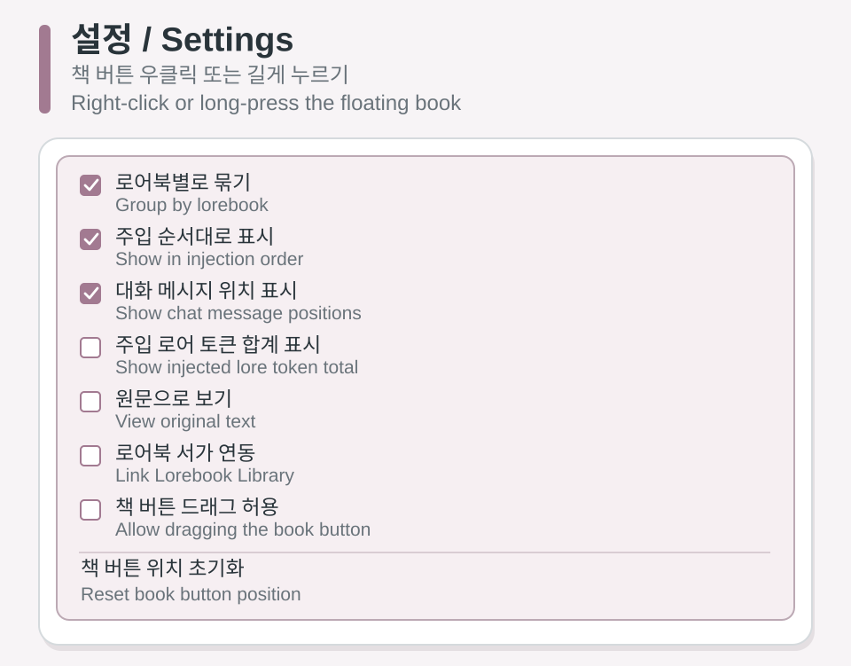

# 📚 WorldInfo Info — Ambasa fork

**WorldInfo Info is a SillyTavern extension for inspecting the lorebook entries activated for the current roleplay reply, reading their contents, and checking recorded activation reasons without leaving the chat.**

This is a fork of [aikohanasaki's WorldInfo Info](https://github.com/aikohanasaki/SillyTavern-WorldInfoInfo), itself based on [LenAnderson's original WorldInfo Info](https://github.com/LenAnderson/SillyTavern-WorldInfoInfo). The floating book, activation list and keyword/recursion report are the work this fork builds upon. Thank you to both authors for making this workflow possible.

## 📸 UI Preview

  

*Illustrated UI examples based on the extension's interface, using fictional lore and sample translations. They are not live screenshots.*

## 📥 Installation and First Steps

1. In SillyTavern, open **Extensions → Install extension** (sometimes under extension management).
2. Paste `https://github.com/AmbasaS2/SillyTavern-WorldInfoInfo`, install, and reload the page.
3. If another WorldInfo Info version is installed, disable or remove it before enabling this fork. Do not run both versions together.
4. Generate a normal RP reply, then click or tap the floating book button to open the latest lore list.

Lorebook Manager and Cherry&Solti's lorebook translator are optional. The core list, reader, and report work independently.

## 🧭 How It Works

  

**Generate a reply → open the floating book → select an entry → read its contents and recorded activation cause.**

The number on the book indicates the tracked activated entries. The list can be grouped by lorebook or arranged by injection position and order. Entries use the existing strategy icons; the reader shows the recorded activation cause separately.

The list follows the latest visible generation. Dry runs (including token-counting passes) and background quiet generations do not replace it. Ordinary activated entries are shown promptly; outlet entries are included after checking that their text appears in the assembled generation request. This is not a complete token-by-token prompt inspector.

## 📖 Read-Only Lore Reader

Select an entry in the list to open a floating reader rather than navigate away to the lorebook editor.

- Read the title and body as formatted Markdown with the active SillyTavern theme and chat typography.
- See recorded causes such as a keyword match, secondary keyword condition, always-active injection, confirmed vector search, sticky continuation, external activation, or an `@@activate` directive. If the cause cannot be established, the reader says so.
- Drag the reader by its header; desktop and mobile reader positions are remembered separately.
- The reader loads the current lorebook entry when opened. It does not edit the lorebook or reconstruct an exact historical copy of the request.

The strategy icon in the list represents the configured activation strategy, not necessarily the actual reason an entry was activated on that generation.

### 🔮 Jev Memory Recall (upcoming)

With the compatible [Memory Books fork](https://github.com/AmbasaS2/SillyTavern-MemoryBooks) and its Jev recall mode enabled, memories selected by Jev and included in the current RP's injected lore list are marked **🔮 Jev**, separately from ordinary always-active entries.

Open a recalled memory to read its contents or an available saved translation. The reader identifies Jev as the activation source; recorded Jev entries are also identified in the recursion report. The optional lore token total includes these memories as part of the injected list.

This integration uses the selection already made by Memory Books. It does not call Jev again or add memories to the prompt. Candidates that do not make it into the injected lore list are not added for display.

**Release status:** Implemented in the integration branches; not available in the current public release (v1.7.1-ambasa.3). Both extensions need the compatible update.

### 🌐 Read Existing Translations

If compatible saved translations exist, the reader can display them without translating the entry again.

- **Ambasa's Lorebook Manager:** reads the current per-lorebook translation JSON when the reader opens; valid translated titles and bodies are supported, as are compatible legacy saved translations.
- **Cherry&Solti's lorebook translator (RT):** uses a valid saved body translation when no usable Manager body translation is available.
- **No usable translation:** displays the original text. Missing, stale, or unavailable translations do not block reading.

This is a read-only integration, not a translation engine. It does not start AI translation, change saved translations, or substitute translated text into the roleplay prompt. Per-book file lookup takes place on reader open, not during generation or list display.

## ⚙️ Settings

Right-click the floating book on desktop or long-press it on mobile.

  

| Setting | What it does | Default |
|---|---|---|
| **Group by lorebook** | Groups entries by their source lorebook. | On |
| **Show in injection order** | Orders entries by insertion position and order rather than title. | On |
| **Show chat message positions** | With grouping off and injection ordering on, shows intervening chat message positions. | On |
| **Show injected lore token total** | Shows an approximate total of the injected lore text after generation has finished and the list is opened. | Off |
| **Link Lorebook Library** | Opens the exact entry in the optional Lorebook Manager Library instead of the built-in reader when available. | Off |
| **Allow dragging the book button** | Lets you move the floating book. | Off |
| **Reset book button position** | Returns the floating book to its original position. | Action |

### 🧮 Optional Token Total

Enable **Show injected lore token total** if you want an estimate of the tokens used by the tracked lore entries. A nonempty list is counted together using SillyTavern's tokenizer after the visible reply finishes; the calculation is deferred until the list is open. The footer is shown as `Total 1,248` (example).

No token-counting work is started during generation or streaming. The total is not the full request token count or an exact API billing figure.

### 📚 Optional Lorebook Library Integration

Enable **Link Lorebook Library** to open an entry in the independent floating library provided by [Ambasa's Lorebook Manager](https://github.com/AmbasaS2/lore-manager) v1.4.85-ambasa.65 or later. Matching uses the lorebook name and entry UID, not its displayed or translated title.

If the manager is absent, disabled, incompatible, or cannot open the entry, the built-in read-only reader opens instead. Leave this option off if you prefer the quick viewer and activation explanation. The setting changes navigation only, not lorebook contents, translation data, or prompt injection.

## 🔎 Keyword and Recursion Report

The `/wi-report` command from aikohanasaki's fork shows recorded keyword matches, occurrence counts, and recursion rounds. The Ambasa fork continues to provide this report; activation records are kept compact, and hidden-book filtering is retained for the report and its visible counts.

A report with no recorded keyword is not proof that a lore entry was never activated; entries can activate for other reasons.

| Command | Function |
|---|---|
| `/wi-report` | Open the lore keyword and recursion report. |
| `/wi-triggered` | Return the last displayed entry list as JSON. |
| `/wi-position-reset` | Reset the floating book position. |

## 🌍 Interface Languages

The interface follows SillyTavern's language setting. English, Korean, Japanese, Simplified Chinese, Traditional Chinese, Spanish, and French UI strings are included. Interface localization does not translate lorebook contents.

## 🔀 What Changed in the Ambasa Fork?

Compared with [aikohanasaki's WorldInfo Info v1.7.0](https://github.com/aikohanasaki/SillyTavern-WorldInfoInfo), the following changes are included in v1.7.1-ambasa.3.

| Area | aikohanasaki's fork | Ambasa fork |
|---|---|---|
| Entry selection | Opens the entry in the lorebook editor. | Opens a floating, read-only Markdown reader by default. |
| Activation information | Existing strategy icons and detailed keyword/recursion report. | Keeps them and adds recorded activation reasons inside the reader. |
| Translations | Existing lorebook entry navigation. | Reads supported saved translations in the floating reader. |
| List lifecycle | Existing activated-entry list. | Ignores non-visible generations and verifies outlet text against the assembled request. |
| Token estimate | Not included in its settings. | Optional on-demand lore-only total. |
| Navigation | Opens the native lorebook editor. | Optional exact-entry navigation to the independent Lorebook Library. |
| Controls and display | Floating button, grouping, ordering, dragging and reset. | Keeps those controls; adds mobile long-press settings, localized UI and viewport-safe themed panels. |

This fork focuses on reading and inspecting lore directly during RP. The original keyword/recursion report and floating list remain central to this fork.

## 🪶 Scope and Performance

The extension observes existing generation events rather than performing a second lorebook activation scan. Sticky metadata is read from existing in-memory state. Opening the list toggles already-rendered entries. Translation lookup is scoped to the selected book when the reader is opened; there is no new polling or automatic AI translation. Optional token counting waits until the reply ends.

WorldInfo Info does not decide what lore should be activated or injected. The core activation rules, probability, budget, recursion, and prompt assembly remain SillyTavern's responsibility.

## 🙏 Credits and License

- **Original extension:** [LenAnderson/SillyTavern-WorldInfoInfo](https://github.com/LenAnderson/SillyTavern-WorldInfoInfo)
- **Direct upstream fork:** [aikohanasaki/SillyTavern-WorldInfoInfo](https://github.com/aikohanasaki/SillyTavern-WorldInfoInfo) — including the floating button movement, click-to-open navigation, and `/wi-report`.
- **This fork:** AmbasaS2 — reading-oriented additions and optional integrations.

This project retains the GNU Affero General Public License v3.0. See [LICENSE](./LICENSE).
