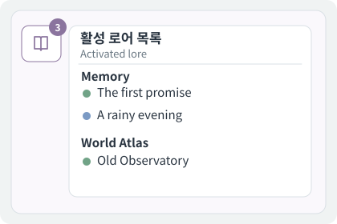
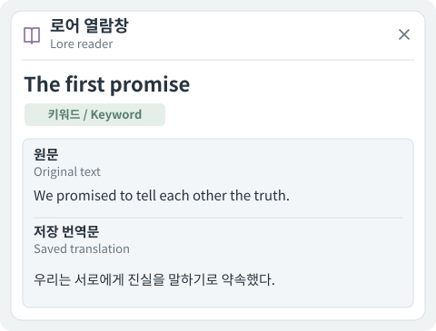
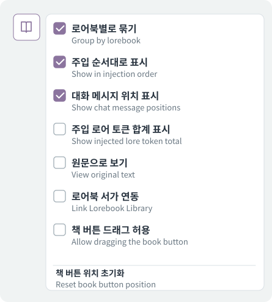
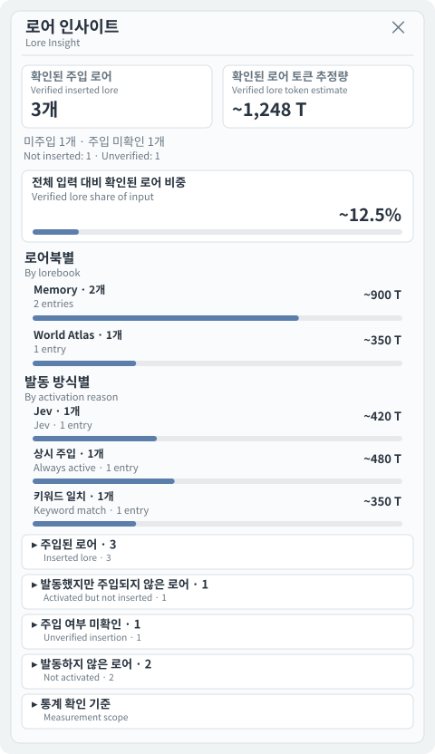
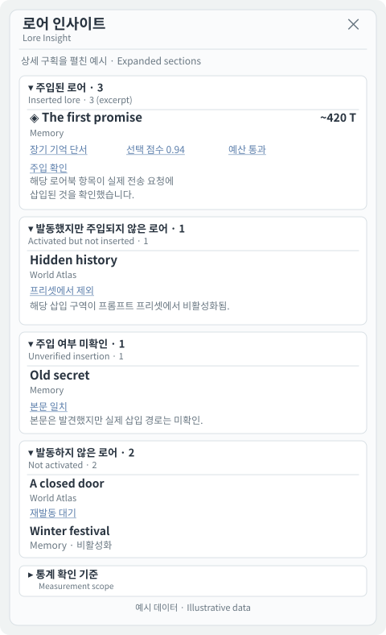

# 📚 WorldInfo Info of Sloth

<!-- Branding update: WorldInfo Info of Sloth; existing installation URL, commands and settings are unchanged. -->

**WorldInfo Info of Sloth is a SillyTavern extension for inspecting the lorebook entries verified as inserted in the current roleplay request, reading their contents, and checking recorded activation reasons without leaving the chat.**

This is a fork of [aikohanasaki's WorldInfo Info](https://github.com/aikohanasaki/SillyTavern-WorldInfoInfo), itself based on [LenAnderson's original WorldInfo Info](https://github.com/LenAnderson/SillyTavern-WorldInfoInfo). The floating book, activation list and keyword/recursion report are the work this fork builds upon. Thank you to both authors for making this workflow possible.

[한국어 안내 ↓](#-월드인포인포)

**Use this when you want to see what actually went into your RP, not change what is injected.**

## 📥 Installation and First Steps

1. In SillyTavern, open **Extensions → Install extension** (sometimes under extension management).
2. Paste `https://github.com/AmbasaS2/SillyTavern-WorldInfoInfo`, install, and reload the page.
3. If another WorldInfo Info version is installed, disable or remove it before enabling this fork. Do not run both versions together.
4. Generate a normal RP reply, then click or tap the floating book button to open the latest lore list.

Lorebook Manager and Cherry&Solti's lorebook translator are optional. The core list, reader, and report work independently.

## Who is this for?

- See which lorebooks and entries are confirmed to be in the latest visible RP request.
- Inspect confirmed exclusions from activated lore, and the count whose insertion cannot be verified.
- Find out why a lore entry activated: matched primary/secondary keywords, constant injection, confirmed vector retrieval, Sticky continuation, external activation or @@activate.
- Troubleshoot unexpected or missing lore using the keyword-frequency and recursion-round report, Sticky counts and injection order.
- Read formatted lore or saved translations in the chat without opening the editor or paying for another translation.
- Check the approximate injected-lore tokens and their share of the input in Lore Insight; identify confirmed Jev entries with compatible STLO, or open the exact entry in the optional Lorebook Manager library.

## ⚡ Quick start

**Current version: 1.7.1-ambasa.19.**

.14 fixes missing verified entries caused by concurrent prompt assemblies, sparse preset slots and complex depth/outlet routing. The book still lists only verified insertions; Lore Insight shows verified insertions and verified omissions from the activation list.

> **Generate a reply → tap the book → choose an entry → read.**
>
> No separate AI setup is needed. This fork inspects confirmed insertion; it does not decide what to recall.

1. Install this fork, not alongside the original, and reload. No separate AI setup is needed. Generate a normal RP reply and tap the floating book.
2. Select an entry to read its current body and recorded cause. The configured strategy icon and actual activation cause can differ.
3. Right-click or long-press the book for grouping, order, optional lore-only token total, dragging and library link. The list's optional footer waits until the reply ends; open **View Lore Insight** to see the analysis even while the reply is streaming, once request evidence is ready.
4. If you use STLO 2.2.4-ambasa.1+ with Jev enabled, confirmed Jev entries show 🔮. If you have the compatible Lorebook Manager (ambasa.65+), optionally turn on the library link; otherwise use the built-in reader.

## 📖 How to use

> The bilingual illustrations are simplified UI mock-ups based on the extension controls in SillyTavern, not screenshots. Values and lorebooks are illustrative examples.

### 1. Generate a reply and open the book

**Generate a reply → open the floating book → select an entry → read its contents and recorded activation cause.**

**What the list tells you**

- **Book number:** the number of entries whose insertion was verified in the correlated pre-send Chat Completion request.
- **Grouping and order:** group by lorebook or show insertion positions and order.
- **Strategy icons:** the configured activation strategy, not necessarily the recorded reason.

> [!NOTE]
> The list follows the latest visible generation. Dry runs (including token counting) and background quiet generations do not replace it. The badge, list, `/wi-triggered`, keyword report and Lore Insight's confirmed totals use the same verified request membership. A matching sentence elsewhere, a scan activation or an unused outlet is not enough. Unverified entries are not counted; see Lore Insight for diagnostics.

<p align="left"></p>

### 2. Select a lore entry to read it

<p align="left"></p>


Select a lore entry to open the floating, read-only reader without leaving the chat.

**What you can read**

- The title and Markdown body, using the active SillyTavern theme and chat typography.
- Recorded primary/secondary keyword values and applicable negative keyword logic.
- Multiple confirmed causes, if recorded.
- A pin and remaining rounds for Sticky entries in the list.

| Recorded cause | Meaning |
| --- | --- |
| Keyword match | A recorded primary/secondary keyword condition matched |
| Always active | Constant injection |
| Vector search | Confirmed vector retrieval |
| Sticky continuation | An earlier activation remains active |
| External activation | Another feature or extension activated the entry |
| `@@activate` | Activation through the directive |
| 🔮 | Selected by Jev in compatible STLO and verified in the request |
| Unknown | Insufficient evidence for the cause |

**Configured strategy ≠ actual cause.** A vectorized entry can activate because a keyword matched.

- **Via outlet:** appended for an outlet whose insertion is verified (e.g. Always active · Via outlet). It describes the insertion route, not a separate cause.
- Text matching can be ambiguous when the same text appears elsewhere or transformed text fails to match.
- Drag the header to move the reader. Desktop and mobile positions are remembered separately.

> [!NOTE]
> The reader loads the current stored entry or saved translation. It is not a reconstruction of the sent text: for example, STLO's optional partial injection can send an excerpt while the reader still opens the stored lore.

### 🌐 Read Existing Translations

**Read a saved translation without making another translation request.**

- Turn **View original text** on to show original titles in the list and original titles/bodies in the built-in reader.
- Turn it off to return to compatible saved translations.
- The independent Lorebook Library follows its own display setting.

- **Lorebook Manager (original and fork):** reads the fork's current per-lorebook translation JSON when the reader opens, and compatible settings-based translations from the original or older fork versions. Valid translated titles and bodies are supported.
- **Cherry&Solti's lorebook translator (RT):** uses a valid saved body translation when no usable Manager body translation is available.
- **No usable translation:** displays the original text. Missing, stale, or unavailable translations do not block reading.

**Read-only integration:** no new AI translation, no changes to saved translations or the RP prompt.

Per-book file lookup happens when the reader opens, not during generation or list display.

### 3. Optional book-button settings

Right-click the floating book on desktop or long-press it on mobile. Both the entry list and settings panel align their top edge with the book whenever the viewport allows.

<p align="left"></p>

| List settings | Default | Effect |
| --- | --- | --- |
| Group by lorebook | On | Group by source lorebook |
| Show in injection order | On | Sort by insertion position and order rather than title |
| Show chat message positions | On | Show intervening messages when grouping is off and injection ordering is on |
| Show injected lore token total | Off | Estimate lore-only tokens after generation, when the list is opened |

| Reading and button settings | Default | Effect |
| --- | --- | --- |
| View original text | Off | Show original list titles and reader titles/bodies; skip translation lookup |
| Link Lorebook Library | Off | Open the exact entry in the compatible library instead of the built-in reader |
| Allow dragging the book button | Off | Move the floating book |
| View Lore Insight | Action | Open the separate read-only RP lore analysis |

> [!TIP]
> To inspect the position of lore relative to chat messages, turn grouping off and keep injection ordering and message positions on.

### 🧮 Optional Token Total

Enable **Show injected lore token total** to show a footer such as `Total 1,248` (example).

- Counts the verified, nonempty rendered lore together using SillyTavern's tokenizer.
- Waits until the visible reply finishes and the list is opened.
- Does not start token counting during generation or streaming.

The total is an estimate of confirmed inserted lore, **not** the full request token count or an exact API bill.

### 📚 Optional Lorebook Library Integration

Enable **Link Lorebook Library** to open an entry in the independent floating library provided by [Sloth the Lorebook Manager](https://github.com/AmbasaS2/lore-manager) v1.4.85-ambasa.65 or later. Matching uses the lorebook name and entry UID, not its displayed or translated title.

If the manager is absent, disabled, incompatible, or cannot open the entry, the built-in read-only reader opens instead. Leave this option off if you prefer the quick viewer and activation explanation. The setting changes navigation only, not lorebook contents, translation data, or prompt injection.

### 4. Lore Insight — what really went into this reply?

Right-click the book (long-press on mobile) → **View Lore Insight**. You can open it while the reply is streaming, once the correlated pre-send request has been checked. Opening it starts the token estimates automatically; no separate AI connection is needed.

<p align="left"></p>

**What can I see?**

- Confirmed inserted lore count and combined lore-token estimate.
- Approximate share of the collected plain-text input; counts grouped by book and recorded activation reason.
- Expand the entries to see per-entry estimates and recorded reasons. The combined estimate and the sum of individual estimates are different measurements.

**Why is a lore missing from the book list?**

<p align="left"></p>


| Section | What it means |
| --- | --- |
| Inserted lore | Insertion verified in the correlated pre-send Chat Completion request |
| Activated but not inserted | An observed omission, such as a disabled preset section or a block omitted during assembly |

Click an underlined term or a reason icon for its explanation. Entries with an unconfirmed outcome contribute only to the uncertainty count.

> [!NOTE]
> This is a read-only estimate of the host request observed immediately before sending, not the provider's final bill. Later transformations and unsupported/unproven routes cannot be verified. Hidden lore is excluded for users without access; the overall share is omitted when visibility is incomplete. Missing measurements are not zero. Closing the window stops further scheduled counting; new generation/chat or incompatible tokenizer context invalidates old measurements.

With compatible STLO 2.2.4-ambasa.6 and WorldInfo Info 1.7.1-ambasa.13, positive Jev receipts can show the candidate route, selection score and budget acceptance. They are recorded values, not a generated explanation of Jev's thoughts. Matching exact per-entry token counts can be reused, and verified RP insertion evidence is shared back with STLO. Neither extension is required for the other's basic features.

### 5. Keyword and Recursion Report

Enter `/wi-report` after a reply to open aikohanasaki's original keyword and recursion report.

**What the report shows**

- Recorded keyword matches and counts, with associated entries.
- Recorded keyword/recursion information for verified inserted entries.
- Hidden-book filtering for non-admin users and visible counts.

**What the report does not show**

- A missing recorded keyword is not proof an entry never activated. Use Lore Insight to see verified omissions from the activation list.
- Jev is a recall source, not a keyword hit.

**Commands**

| Command | Action |
| --- | --- |
| `/wi-report` | Open the keyword and recursion report |
| `/wi-triggered` | Return the last displayed list as JSON |
| `/wi-position-reset` | Reset the floating book position |

**Automatic log housekeeping**

- Saves only the latest successfully captured report with the chat (up to 64 KiB of UTF-8 JSON).
- Keeps oversized reports complete in the current session and marks shortened saved reports.
- Retires legacy diagnostic logs and duplicate recursion metadata after a verified scan, using the usual chat save.
- Leaves previous saved data untouched if capture is incomplete.

No cleanup command or background file scan is needed.

## 🌍 Interface Languages

The interface follows SillyTavern's language setting. English, Korean, Japanese, Simplified Chinese, Traditional Chinese, Spanish, and French UI strings are included. Interface localization does not translate lorebook contents.

## 🔀 What’s new?

Compared with [aikohanasaki's WorldInfo Info v1.7.0](https://github.com/aikohanasaki/SillyTavern-WorldInfoInfo), the following changes are included in v1.7.1-ambasa.14.

**Entry selection**  
**Original**: Opens the entry in the lorebook editor.  
**Current version**: Opens a floating, read-only Markdown reader by default.

**Activation information**  
**Original**: Existing strategy icons and detailed keyword/recursion report.  
**Current version**: Keeps them and adds recorded activation reasons inside the reader.

**Translations**  
**Original**: Existing lorebook entry navigation.  
**Current version**: Reads supported saved translations in the floating reader.

**List lifecycle**  
**Original**: Existing activated-entry list.  
**Current version**: Ignores non-visible generations; list membership requires verified insertion in the correlated pre-send request.

**Token estimate**  
**Original**: Not included in its settings.  
**Current version**: Optional lore-only footer plus Lore Insight (live, on-open estimates and separate diagnostics).

**Navigation**  
**Original**: Opens the native lorebook editor.  
**Current version**: Optional exact-entry navigation to the independent Lorebook Library.

**Controls and display**  
**Original**: Floating button, grouping, ordering, dragging and reset.  
**Current version**: Keeps grouping, ordering and dragging; adds mobile long-press settings, localized UI and viewport-safe themed panels. The menu's former reset action is now Lore Insight; `/wi-position-reset` remains.

This fork focuses on reading and inspecting lore directly during RP. The original keyword/recursion report and floating list remain central to this fork.

## 🪶 Scope and Performance

- **Activation tracking:** observes existing generation events, without a second lorebook activation scan.
- **Sticky:** reads existing in-memory metadata.
- **List:** defers closed-panel rendering; only confirmed request members are shown.
- **Translation:** looks up the selected book when its reader opens; no new polling or automatic AI translation.
- **Token count:** optional footer after the reply ends; Lore Insight counts only on open, including during streaming. Collapsed diagnostic sections are built on demand.

WorldInfo Info does not decide what lore should be activated or injected. The core activation rules, probability, budget, recursion, and prompt assembly remain SillyTavern's responsibility.

## 🧩 Works well with

Compatible STLO marks actual Jev activation without a second request. Compatible Lorebook Manager reads saved translations and optionally opens the exact entry by book name and UID. Memory Books is not required to inspect Jev or any other lore.

[Lorebook Ordering for Sloths](https://github.com/AmbasaS2/SillyTavern-LorebookOrdering) · [Sloth the Lorebook Manager / 로어북 매니저: 게으름뱅이](https://github.com/AmbasaS2/lore-manager) · [Sloth's Memory Books / 게으름뱅이의 메모리북](https://github.com/AmbasaS2/SillyTavern-MemoryBooks)

The detailed sections below explain optional settings. Compatibility is version-dependent; it does not guarantee every third-party extension or device.

### 🔮 Jev Recall via STLO

With the compatible [Lorebook Ordering for Sloths](https://github.com/AmbasaS2/SillyTavern-LorebookOrdering), enable Jev for the current character in the separate Lorebook Jev Recall menu (group chats use book-level opt-ins). Exclude individual books in Lorebook Budget Management if needed. The injected lore list shows **🔮** for lore selected by Jev and verified in the current RP request.

This works with any supported lorebook enabled for Jev in STLO: memories, character information, world lore or NPC records. Memory Books is not required. Open an entry to read its contents or an available saved translation. The built-in reader and recorded entries in the recursion report identify Jev as the recall source. The optional lore token total includes these entries as part of the injected list.

WorldInfo Info uses STLO's existing selection receipt and verified request insertion evidence. It does not call Jev again, search lorebooks again, change the prompt or bypass token budgets. Entries rejected by STLO or SillyTavern's activation rules are not added for display.

**Compatibility:** The original optional Jev marker is available from WorldInfo Info .4 and STLO .1 in compatible builds. For shared metrics and verified-request evidence, use WorldInfo Info 1.7.1-ambasa.13 and STLO 2.2.4-ambasa.6. Each extension works independently.

---

<a id="-월드인포인포"></a>

# 📚 게으름뱅이가 읽는 월드인포인포

**이번 RP에 어떤 로어가 실제로 주입됐는지 채팅 화면에서 바로 확인하는 확장입니다.** 로어를 새로 만들거나 주입 여부를 결정하는 확장이 아닙니다.

## 다운로드

확장 설치 메뉴에 아래 주소를 입력하고 설치한 뒤 새로고침합니다. 기존 WorldInfo Info와 동시에 실행하지 마세요.

```
https://github.com/AmbasaS2/SillyTavern-WorldInfoInfo
```

## 이 확장, 누가 쓰면 좋을까? ✍️(◔◡◔)

- 👀 이번 답변에 어느 로어북의 어떤 항목이 **실제 주입됐는지** 확인하고 싶은 사람
- 🔎 발동한 로어 중에서 실제로 주입된 항목과 미주입이 확인된 항목을 보고 싶은 사람
- 기본·보조 키워드 일치, 상시 주입, 벡터 검색, Sticky 유지, 외부 활성화, @@activate 등 기록된 실제 발동 이유를 알고 싶은 분
- 키워드 일치 횟수·재귀 단계·Sticky 남은 횟수·주입 위치와 순서로 예상 밖의 발동 원인을 추적하고 싶은 분
- 채팅을 벗어나지 않고 마크다운 본문과 이미 저장한 번역을 읽고 싶은 분
- 🧮 로어가 몇 토큰이나 들어갔는지, 어느 책이 많이 차지하는지 궁금한 사람
- 호환 STLO의 Jev 출처를 구분하고 로어북 매니저에서 해당 항목을 바로 열고 싶은 사람

## ⚡ 간단 사용 설명

**현재 버전: 1.7.1-ambasa.19.**

.14에서는 동시 프롬프트 조립, 빈 프리셋 슬롯, 복합 깊이·아웃렛 경로에서 실제 주입 항목이 누락되던 문제를 수정했어요. 책에는 실제 주입 확인 항목만 표시하고, 로어 인사이트에는 주입 확인 목록과 발동 후 미주입 확인 목록이 있습니다.

> **평소처럼 롤플 → 책 버튼 → 궁금한 로어 누르기!**
>
> 캐릭터가 왜 그 설정을 기억했는지 확인할 수 있어요. 별도 AI 연결이나 다른 확장은 필요 없습니다. 로어를 새로 호출하는 확장이 아닙니다.

1. 원본과 동시에 켜지 말고 설치·새로고침  → 별도 AI 설정 없이 일반 RP 답변 생성 → 책 버튼 누르기.
2. 항목을 눌러 현재 저장 본문과 기록된 발동 이유를 읽습니다. 설정상 발동 방식과 실제 원인은 다를 수 있습니다.
3. PC 우클릭·모바일 길게 누르기로 그룹화·정렬·토큰 합계·드래그·서가 연동을 선택합니다. **로어 인사이트 보기**를 누르면 답변 생성 중에도 주입 확인 결과와 토큰 추정을 볼 수 있어요. 목록 아래의 선택적 토큰 합계는 답변 종료 후 계산합니다.
4. 호환 STLO에서 Jev를 사용하면 실제 주입이 확인된 항목에 🔮가 표시됩니다. 로어북 매니저(ambasa.65+)가 있으면 선택적으로 서가 연동을 켜고, 없으면 기본 열람창을 사용합니다.

## 📖 사용 설명서

> 안내 이미지는 실제 실리태번 확장의 조작 화면을 바탕으로 정리한 한영 병기 UI 목업입니다. 설정값과 로어북은 이해를 돕기 위한 예시입니다.

### 1. 답변을 생성하고 책 버튼 누르기

평소처럼 롤플하고 떠 있는 책 버튼을 누릅니다.

- 책 버튼의 숫자: 실제 전송 직전 요청에 삽입된 것으로 확인한 로어 항목 수
- 목록: 마지막 일반 RP 기준
- 로어 제목을 누르면 열람창이 열립니다.

> [!NOTE]
> 토큰 계산용 미리보기나 quiet generation은 목록을 덮어쓰지 않습니다. 발동했다고 무조건 책 목록에 나오는 것은 아니에요. 전송 직전 Chat Completion 요청에서 실제 삽입 경로와 내용이 확인된 항목만 표시합니다. 발동한 로어 중 미주입이 확인된 항목은 로어 인사이트에서 볼 수 있어요.

<p align="left"></p>

### 2. 본문과 발동 이유 읽기

<p align="left"></p>


**목록의 아이콘과 실제 발동 이유는 다를 수 있어요!**

벡터화로 설정한 로어가 이번에는 키워드 일치로 발동할 수도 있습니다. 열람창에서 기록된 실제 원인을 확인하세요.

| 발동 이유 | 뜻 |
| --- | --- |
| 🟢 키워드 일치 | 기본·보조 키워드 조건 일치 |
| 🔵 상시 주입 | 항상 활성화되는 항목 |
| 벡터 검색 | 확인된 벡터 검색 결과 |
| 📌 Sticky 유지 | 이전 발동이 유지되는 상태 |
| 외부 활성화 | 다른 확장·기능이 활성화 |
| `@@activate` | 해당 지시에 따른 활성화 |
| 🔮 | 호환 STLO의 Jev가 고른 로어 중 주입이 확인된 항목 |
| 확인 불가 | 원인을 확인할 기록이 부족함 |

일치한 기본·보조 키워드와 부정 조건 논리도 기록된 경우 표시합니다. 여러 원인이 확인되면 함께 표시할 수 있어요. 목록의 📌 숫자는 Sticky의 남은 유지 횟수입니다.

**아웃렛 경유가 뭔가요?**

- 예: 🔵 상시 주입 · 아웃렛 경유
- 실제 아웃렛 삽입이 확인됐을 때 덧붙이는 주입 경로입니다. 별도의 발동 원인은 아닙니다.
- 동일한 문장이 다른 위치에 있거나 매크로 등으로 본문이 변형되면 판별이 어려울 수 있습니다.

#### 🌐 저장된 번역문 읽기

| 호환 번역 | 읽는 내용 |
| --- | --- |
| 로어북 매니저 원본·포크 | 유효한 제목·본문 번역 |
| Cherry&Solti RT | 매니저 본문 번역이 없을 때 저장 본문 번역 |
| 사용할 수 있는 번역 없음 | 원문 |

**원문을 보고 싶다면?** 책 버튼 설정 → **원문으로 보기** 체크.

- 켜면 목록 제목과 기본 열람창 제목·본문을 원문으로 표시합니다.
- 끄면 다시 저장 번역을 우선 표시합니다.
- 독립 서재는 자체 표시 설정을 따릅니다.

> [!TIP]
> 새 번역 요청은 없으며 AI에 들어가는 로어도 바꾸지 않습니다. 현재 저장된 본문을 읽는 기능이므로 실제 전송 본문을 그대로 복원하는 창은 아니에요. STLO의 부분 주입을 사용해 일부만 들어갔더라도 열람창에서는 저장된 로어를 읽습니다.

창 헤더를 끌어 위치를 옮길 수 있습니다. 모바일·PC 위치는 따로 기억합니다.

### 3. 설정하기

책 버튼을 PC에서 우클릭하거나 모바일에서 길게 누릅니다. 목록과 설정창 모두 화면 공간이 허용하는 한 책 버튼의 윗선에 맞춰 열립니다.

<p align="left"></p>

| 목록 설정 | 기본값 | 설명 |
| --- | --- | --- |
| 로어북별로 묶기 | 켜짐 | 책별로 표시 |
| 주입 순서대로 표시 | 켜짐 | 끄면 제목순 |
| 대화 메시지 위치 표시 | 켜짐 | 책별 묶기 OFF·주입 순서 ON일 때 표시 |
| 주입 로어 토큰 합계 표시 | 꺼짐 | 답변 후 목록을 열 때 로어 토큰 근사값 계산 |

| 열람·버튼 설정 | 기본값 | 설명 |
| --- | --- | --- |
| 원문으로 보기 (View original text) | 꺼짐 | 목록 제목과 기본 열람창 제목·본문 원문 표시, 번역 조회 생략 |
| 로어북 서가 연동 | 꺼짐 | 호환 로어북 매니저 서재에서 정확한 항목 열기 |
| 책 버튼 드래그 허용 | 꺼짐 | 원하는 위치로 이동 |
| 로어 인사이트 보기 | 실행 버튼 | 최근 RP 로어 분석 창 열기 |

> [!TIP]
> 책별 묶기만 끄고 주입 순서와 대화 메시지 위치 표시를 켜면 책 구분 없이 주입 배치를 확인할 수 있어요.

서가 연동에 실패하거나 호환 확장이 없으면 기본 열람창을 엽니다. 번역기나 서재 확장은 필수가 아닙니다.

### 4. 로어 인사이트 — 대체 뭐가 얼마나 들어갔지?

책 버튼 PC 우클릭 / 모바일 꾹 누르기 → **로어 인사이트 보기**!

전송 직전 요청 확인이 끝나면 답변 생성 중에도 열 수 있어요. 창을 열 때만 토큰을 자동 추정하므로 따로 AI를 연결하거나 버튼을 하나 더 누를 필요 없습니다.

<p align="left"></p>

**확인할 수 있는 것**

- 확인된 주입 로어 수와 합친 본문의 토큰 추정량
- 전체 입력 대비 확인된 로어의 대략적인 비중
- 로어북별·실제 발동 방식별 항목 수와 토큰 추정량
- 항목별 발동 이유·토큰 추정치 (상세 구획을 펼쳐 확인)

합친 본문의 토큰 추정치와 항목별 추정치의 합은 계산 범위가 달라 같지 않을 수 있어요.

**‘발동했는데 왜 책 목록에 없지?’**

<p align="left"></p>


| 구획 | 뜻 |
| --- | --- |
| 주입된 로어 | 전송 직전 요청에서 실제 삽입 확인 |
| 발동했지만 주입되지 않은 로어 | 프리셋에서 제외되었거나 입력 구성에서 빠진 것이 확인됨 |

밑줄이 있는 짧은 용어나 발동 아이콘을 누르면 뜻이 펼쳐집니다. 주입 여부가 확인되지 않은 항목은 개수로만 알려줘요.

> [!NOTE]
> 토큰은 전송 직전 실리태번 요청의 확인된 본문에 대한 추정치입니다. 공급자 청구 토큰과는 다르고, 이후 변경되거나 확인되지 않은 경로까지 보장하지 않아요. 숨겨진 로어를 볼 수 없는 경우 전체 비중은 계산하지 않습니다. 미계측은 0이 아닙니다. 창을 닫으면 추가 예정 계산은 멈추고 새 채팅·생성이나 토크나이저 변경 시 예전 계측을 그대로 재사용하지 않습니다.

**🔮 STLO도 쓰신다면?**

호환 STLO 2.2.4-ambasa.6과 월드인포인포 1.7.1-ambasa.13을 함께 사용하면 Jev가 고른 항목에서 후보 경로, 선택 점수, 예산 통과 여부를 확인할 수 있어요. Jev가 직접 반환한 기록이지 새로 만들어 낸 이유는 아닙니다. 동일한 본문·토크나이저의 개별 토큰 계측을 공유하고, 주입 확인 결과는 STLO 보고서에도 전달합니다. 연동 없이도 로어 인사이트는 사용할 수 있어요.

### 5. 키워드·재귀 보고서

| 명령어 | 기능 |
| --- | --- |
| `/wi-report` | 키워드 일치·재귀 단계·발동 횟수 보고서 열기 |
| `/wi-triggered` | 마지막 목록 JSON 반환 |
| `/wi-position-reset` | 책 버튼 위치 초기화 |

**보고서에서 확인하는 것**

- 키워드별 기록된 일치 횟수와 관련 항목
- 확인된 주입 로어의 재귀 단계별 기록
- Jev는 키워드 빈도에 포함하지 않습니다.
- 숨김 로어북과 비관리자 표시 규칙도 적용합니다.

**재귀란?** 먼저 발동한 로어의 본문에 다른 로어의 키워드가 있어서 연달아 발동하는 경우예요. 기록이 부족하면 원인을 확인하기 어렵습니다.

**로그는 자동으로 정리합니다.**

- 정상 수집된 최신 보고서만 채팅에 최대 64KiB(UTF-8 JSON) 저장
- 상한 초과: 현재 세션은 전체 보고서, 저장본은 일부 생략 안내 표시
- 정상 스캔 후: 구버전 상세 로그·중복 재귀 기록을 기존 채팅 저장 과정에서 자동 정리
- 수집 불완전: 이전 기록 유지

별도 정리 명령어나 전체 채팅 파일 검사는 필요 없습니다.

## 🧩 함께 쓰면 좋은 확장

호환 STLO의 실제 Jev 결과를 추가 요청 없이 표시합니다. 호환 로어북 매니저의 저장 번역을 읽거나 책 이름과 UID로 정확한 서재 항목을 엽니다. 메모리북은 Jev 표시나 일반 로어 확인에 필수가 아닙니다.

[Lorebook Ordering for Sloths](https://github.com/AmbasaS2/SillyTavern-LorebookOrdering) · [Sloth the Lorebook Manager / 로어북 매니저: 게으름뱅이](https://github.com/AmbasaS2/lore-manager) · [Sloth's Memory Books / 게으름뱅이의 메모리북](https://github.com/AmbasaS2/SillyTavern-MemoryBooks)

아래에서 필요한 설정만 자세히 읽으세요. 지원 버전 기준이며 모든 기기·다른 확장 조합을 보장하는 것은 아닙니다.

### 🔮 Jev 표시 연동

로어 목록에서 🔮 아이콘은 Jev가 선택하고 주입이 확인된 로어를 뜻합니다. 최신 월드인포인포(.14)와 STLO(.7)는 실제 요청의 주입 확인 항목과 계측을 연동해요. 열람창·기록된 재귀 보고서와 로어 인사이트에서도 확인할 수 있습니다. 둘 중 하나만 설치하거나 구버전을 사용해도 각 확장의 기본 기능은 유지됩니다.

**안내 기준:** 1.7.1-ambasa.14. 실제 요청 삽입 확인·로어 인사이트·STLO 통계 연동의 세부 범위와 검증 이력은 [개발 기록](docs/lore-insight-v1.md)을 참고하세요.

## 🙏 Credits and License

- **Original extension:** [LenAnderson/SillyTavern-WorldInfoInfo](https://github.com/LenAnderson/SillyTavern-WorldInfoInfo)
- **Direct upstream fork:** [aikohanasaki/SillyTavern-WorldInfoInfo](https://github.com/aikohanasaki/SillyTavern-WorldInfoInfo) — including the floating button movement, click-to-open navigation, and `/wi-report`.
- **This fork:** reading-oriented additions and optional integrations.

This project retains the GNU Affero General Public License v3.0. See [LICENSE](./LICENSE).


For release history, verified host-test scope, limitations and rollback points, see [Lore Insight development and verification notes](docs/lore-insight-v1.md).
