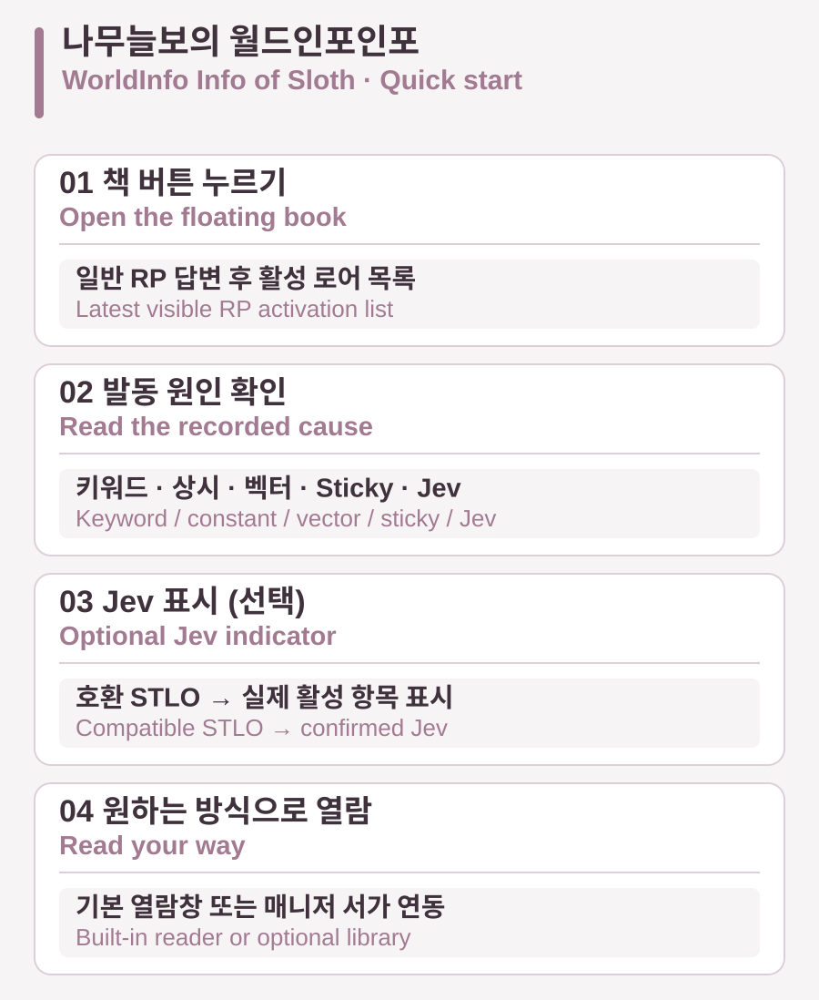
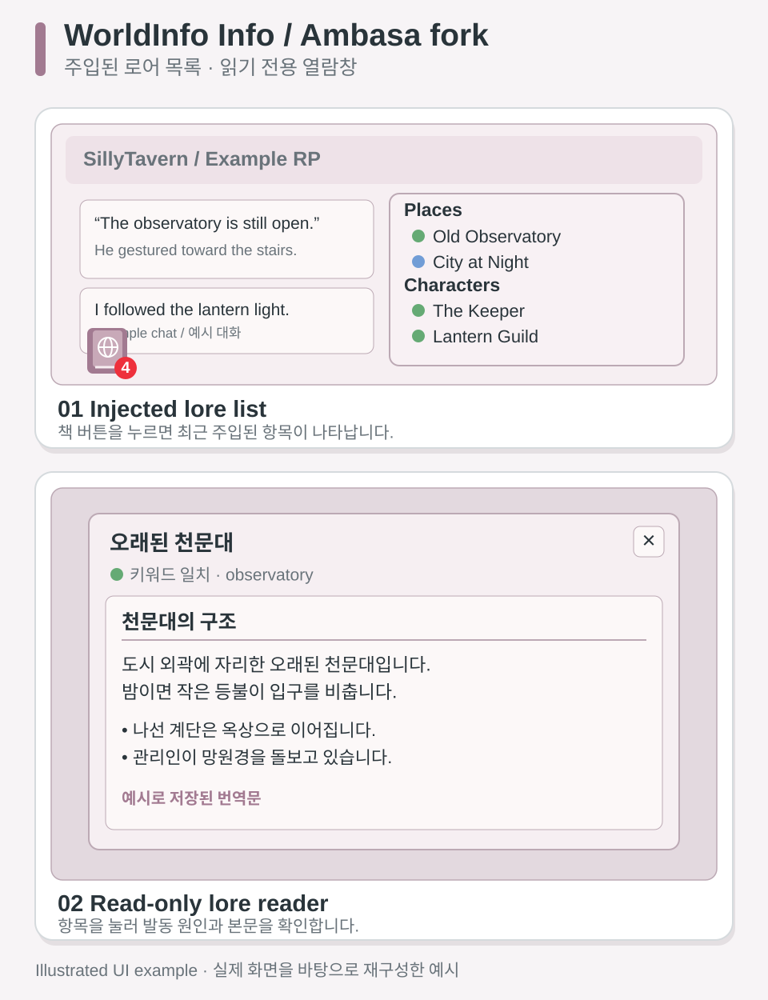
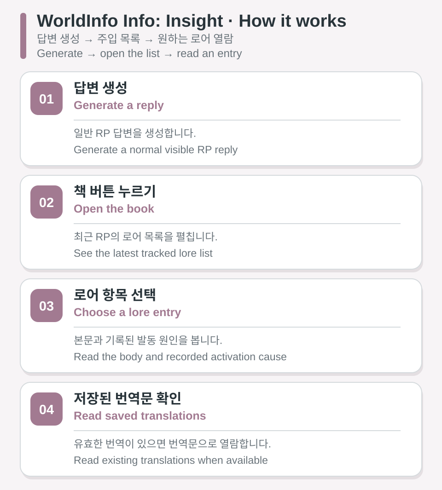
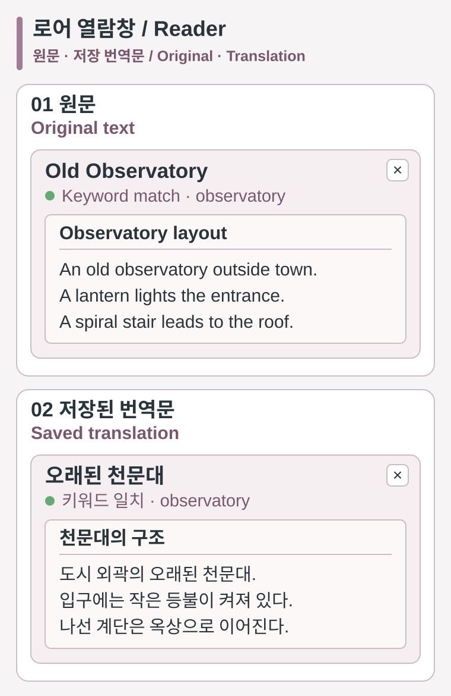
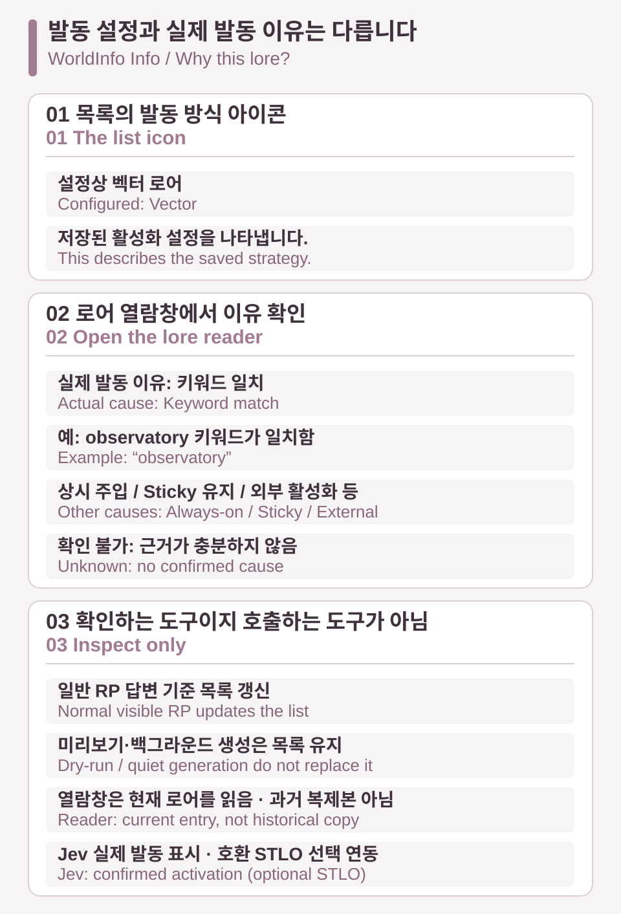

# 📚 WorldInfo Info

**WorldInfo Info is a SillyTavern extension for inspecting the lorebook entries activated for the current roleplay reply, reading their contents, and checking recorded activation reasons without leaving the chat.**

This is a fork of [aikohanasaki's WorldInfo Info](https://github.com/aikohanasaki/SillyTavern-WorldInfoInfo), itself based on [LenAnderson's original WorldInfo Info](https://github.com/LenAnderson/SillyTavern-WorldInfoInfo). The floating book, activation list and keyword/recursion report are the work this fork builds upon. Thank you to both authors for making this workflow possible.

[한국어 안내 ↓](#-월드인포인포)

**Use this when you want to inspect what lore was activated, not change what is injected.**

## Start here — WorldInfo Info in five minutes

**Current version: 1.7.1-ambasa.5.** Check which lore actually activated for a normal visible RP reply, what it contains and its recorded activation cause. This is an inspection tool, not a recall engine. No separate AI or other extension is required.

<p align="center"></p>

1. Install this fork, not alongside the original, and reload. No separate AI setup is needed. Generate a normal RP reply and tap the floating book.
2. Select an entry to read its current body and recorded cause. The configured strategy icon and actual activation cause can differ.
3. Right-click or long-press the book for grouping, order, optional lore-only token total, dragging and library link. Token counting waits until the reply ends and the list is open.
4. If you use STLO 2.2.4-ambasa.1+ with Jev enabled, confirmed Jev entries show 🔮. If you have the compatible Lorebook Manager (ambasa.65+), optionally turn on the library link; otherwise use the built-in reader.

### Works alone, better together

Compatible STLO marks actual Jev activation without a second request. Compatible Lorebook Manager reads saved translations and optionally opens the exact entry by book name and UID. Memory Books is not required to inspect Jev or any other lore.

[STLO](https://github.com/AmbasaS2/SillyTavern-LorebookOrdering) · [Lorebook Manager / 로어북 매니저](https://github.com/AmbasaS2/lore-manager) · [Memory Books / 메모리북](https://github.com/AmbasaS2/SillyTavern-MemoryBooks)

The detailed sections below explain optional settings. Compatibility is version-dependent; it does not guarantee every third-party extension or device.

## Who is this for?

- See which lorebooks and entries actually activated for the latest visible reply.
- Find out why a lore entry activated: matched primary/secondary keywords, constant injection, confirmed vector retrieval, Sticky continuation, external activation or @@activate.
- Troubleshoot unexpected or missing lore using the keyword-frequency and recursion-round report, Sticky counts and injection order.
- Read formatted lore or saved translations in the chat without opening the editor or paying for another translation.
- Check an approximate activated-lore token total, identify actual Jev activations with compatible STLO, or open the exact entry in the optional Lorebook Manager library.

## 📸 UI Preview

<p align="center">
  <a href="assets/readme/mobile/worldinfo-info-preview-mobile.svg"></a>
</p>

*Illustrated UI examples based on the extension's interface, using fictional lore and sample translations. They are not live screenshots.*

## 📥 Installation and First Steps

1. In SillyTavern, open **Extensions → Install extension** (sometimes under extension management).
2. Paste `https://github.com/AmbasaS2/SillyTavern-WorldInfoInfo`, install, and reload the page.
3. If another WorldInfo Info version is installed, disable or remove it before enabling this fork. Do not run both versions together.
4. Generate a normal RP reply, then click or tap the floating book button to open the latest lore list.

Lorebook Manager and Cherry&Solti's lorebook translator are optional. The core list, reader, and report work independently.

## 🧭 How It Works

<p align="center">
  <a href="assets/readme/mobile/worldinfo-info-workflow-guide-mobile.svg"></a>
</p>

**Generate a reply → open the floating book → select an entry → read its contents and recorded activation cause.**

The number on the book indicates the tracked activated entries. The list can be grouped by lorebook or arranged by injection position and order. Entries use the existing strategy icons; the reader shows the recorded activation cause separately.

The list follows the latest visible generation. Dry runs (including token-counting passes) and background quiet generations do not replace it. Ordinary activated entries are shown promptly; outlet entries are included after checking that their text appears in the assembled generation request. This is not a complete token-by-token prompt inspector.

## 📖 Read-Only Lore Reader

<p align="center"></p>


Select an entry in the list to open a floating reader rather than navigate away to the lorebook editor.

- Read the title and body as formatted Markdown with the active SillyTavern theme and chat typography.
- See recorded causes such as a keyword match, secondary keyword condition, always-active injection, confirmed vector search, sticky continuation, external activation, or an `@@activate` directive. If the cause cannot be established, the reader says so. Recorded primary and secondary keyword values can be displayed, as can applicable negative keyword logic. Multiple confirmed causes may be shown together. The list shows a pin and remaining rounds for active Sticky entries.
- Drag the reader by its header; desktop and mobile reader positions are remembered separately.
- The reader loads the current lorebook entry when opened. It does not edit the lorebook or reconstruct an exact historical copy of the request.

The strategy icon in the list represents the configured activation strategy, not necessarily the actual reason an entry was activated on that generation.

<p align="center"></p>

### 🔮 Jev Recall via STLO

With the compatible [ST Lorebook Ordering (STLO) fork](https://github.com/AmbasaS2/SillyTavern-LorebookOrdering), enable Jev for the current character in the separate Lorebook Jev Recall menu (group chats use book-level opt-ins). Exclude individual books in Lorebook Budget Management if needed. Lore selected by Jev and included in the current RP's injected lore list is marked **🔮 Jev**, separately from ordinary always-active, keyword, vector and manually activated entries.

This works with any supported lorebook enabled for Jev in STLO: memories, character information, world lore or NPC records. Memory Books is not required. Open an entry to read its contents or an available saved translation. The built-in reader and recorded entries in the recursion report identify Jev as the recall source. The optional lore token total includes these entries as part of the injected list.

WorldInfo Info uses STLO's existing selection and the final World Info activation results. It does not call Jev again, search lorebooks again, change the prompt or bypass token budgets. Entries rejected by STLO or SillyTavern's activation rules are not added for display.

**Compatibility:** WorldInfo Info v1.7.1-ambasa.4 and STLO v2.2.4-ambasa.1 or later compatible versions provide this optional display integration. With either older version, ordinary lore display and recall continue independently.

### 🌐 Read Existing Translations

If compatible saved translations exist, the built-in reader displays them by default without translating the entry again. Enable **View original text** in the book button settings to display original titles and bodies instead; turn it off to return to saved translations. This also applies to titles in the WorldInfo Info list. The independent Lorebook Library keeps its own display settings.

- **Lorebook Manager (original and fork):** reads the fork's current per-lorebook translation JSON when the reader opens, and compatible settings-based translations from the original or older fork versions. Valid translated titles and bodies are supported.
- **Cherry&Solti's lorebook translator (RT):** uses a valid saved body translation when no usable Manager body translation is available.
- **No usable translation:** displays the original text. Missing, stale, or unavailable translations do not block reading.

This is a read-only integration, not a translation engine. It does not start AI translation, change saved translations, or substitute translated text into the roleplay prompt. Per-book file lookup takes place on reader open, not during generation or list display.

## ⚙️ Settings

Right-click the floating book on desktop or long-press it on mobile.

<p align="center">
  <a href="assets/readme/mobile/worldinfo-info-settings-guide-mobile.svg"></a>
</p>

| Setting | What it does | Default |
|---|---|---|
| **Group by lorebook** | Groups entries by their source lorebook. | On |
| **Show in injection order** | Orders entries by insertion position and order rather than title. | On |
| **Show chat message positions** | With grouping off and injection ordering on, shows intervening chat message positions. | On |
| **Show injected lore token total** | Shows an approximate total of the injected lore text after generation has finished and the list is opened. | Off |
| **View original text** | Shows original titles in the list and original titles and bodies in the built-in reader; skips saved-translation lookup. | Off |
| **Link Lorebook Library** | Opens the exact entry in the optional Lorebook Manager Library instead of the built-in reader when available. | Off |
| **Allow dragging the book button** | Lets you move the floating book. | Off |
| **Reset book button position** | Returns the floating book to its original position. | Action |

### 🧮 Optional Token Total

Enable **Show injected lore token total** if you want an estimate of the tokens used by the tracked lore entries. A nonempty list is counted together using SillyTavern's tokenizer after the visible reply finishes; the calculation is deferred until the list is open. The footer is shown as `Total 1,248` (example).

No token-counting work is started during generation or streaming. The total is not the full request token count or an exact API billing figure.

### 📚 Optional Lorebook Library Integration

Enable **Link Lorebook Library** to open an entry in the independent floating library provided by [Lorebook Manager fork](https://github.com/AmbasaS2/lore-manager) v1.4.85-ambasa.65 or later. Matching uses the lorebook name and entry UID, not its displayed or translated title.

If the manager is absent, disabled, incompatible, or cannot open the entry, the built-in read-only reader opens instead. Leave this option off if you prefer the quick viewer and activation explanation. The setting changes navigation only, not lorebook contents, translation data, or prompt injection.

## 🔎 Keyword and Recursion Report

The `/wi-report` command from aikohanasaki's fork shows recorded keyword matches, occurrence counts, and recursion rounds. This version continues to provide this report; activation records are kept compact, and hidden-book filtering is retained for the report and its visible counts.

A report with no recorded keyword is not proof that a lore entry was never activated; entries can activate for other reasons. The report lists keyword counts and associated entries, with a per-recursion-round breakdown. Jev is a recall source, not a keyword hit. Hidden-lorebook rules are respected for non-admin users and visible report counts.

| Command | Function |
|---|---|
| `/wi-report` | Open the lore keyword and recursion report. |
| `/wi-triggered` | Return the last displayed entry list as JSON. |
| `/wi-position-reset` | Reset the floating book position. |

## 🌍 Interface Languages

The interface follows SillyTavern's language setting. English, Korean, Japanese, Simplified Chinese, Traditional Chinese, Spanish, and French UI strings are included. Interface localization does not translate lorebook contents.

## 🔀 What’s new?

Compared with [aikohanasaki's WorldInfo Info v1.7.0](https://github.com/aikohanasaki/SillyTavern-WorldInfoInfo), the following changes are included in v1.7.1-ambasa.5.

| Area | Original | Current version |
|---|---|---|
| Entry selection | Opens the entry in the lorebook editor. | Opens a floating, read-only Markdown reader by default. |
| Activation information | Existing strategy icons and detailed keyword/recursion report. | Keeps them and adds recorded activation reasons inside the reader. |
| Translations | Existing lorebook entry navigation. | Reads supported saved translations in the floating reader. |
| List lifecycle | Existing activated-entry list. | Ignores non-visible generations and verifies outlet text against the assembled request. |
| Token estimate | Not included in its settings. | Optional on-demand lore-only total. |
| Navigation | Opens the native lorebook editor. | Optional exact-entry navigation to the independent Lorebook Library. |
| Controls and display | Floating button, grouping, ordering, dragging and reset. | Keeps those controls; adds mobile long-press settings, localized UI and viewport-safe themed panels. |

This fork focuses on reading and inspecting lore directly during RP. The original keyword/recursion report and floating list remain central to this fork.

## 🪶 Scope and Performance

The extension observes existing generation events rather than performing a second lorebook activation scan. Sticky metadata is read from existing in-memory state. Opening the list toggles already-rendered entries. Translation lookup is scoped to the selected book when the reader is opened; there is no new polling or automatic AI translation. Optional token counting waits until the reply ends.

WorldInfo Info does not decide what lore should be activated or injected. The core activation rules, probability, budget, recursion, and prompt assembly remain SillyTavern's responsibility.

---

# 📚 월드인포인포

**이번 RP에 어떤 로어가 불러와졌는지 채팅 화면에서 바로 확인하는 확장입니다.** 로어를 새로 만들거나 주입 여부를 결정하는 확장이 아닙니다.


## 다운로드

확장 설치 메뉴에 아래 주소를 입력하고 설치한 뒤 새로고침합니다. 기존 WorldInfo Info와 동시에 실행하지 마세요.

```
https://github.com/AmbasaS2/SillyTavern-WorldInfoInfo
```

## 먼저 읽어 보세요 · 처음 사용하는 분을 위한 5분 안내

**현재 버전: 1.7.1-ambasa.5.** 캐릭터가 왜 그 설정을 기억했는지 궁금할 때, 최근 일반 RP에서 추적된 활성 로어와 발동 이유를 확인합니다. 로어를 새로 호출하는 확장이 아니며 별도 AI나 다른 확장 없이 사용할 수 있습니다.

1. 원본과 동시에 켜지 말고 설치·새로고침  → 별도 AI 설정 없이 일반 RP 답변 생성 → 책 버튼 누르기.
2. 항목을 눌러 현재 저장 본문과 기록된 발동 이유를 읽습니다. 설정상 발동 방식과 실제 원인은 다를 수 있습니다.
3. PC 우클릭·모바일 길게 누르기로 그룹화·정렬·토큰 합계·드래그·서가 연동을 선택합니다. 토큰 계산은 답변 종료 후 목록을 열 때 진행합니다.
4. STLO 2.2.4-ambasa.1 이상 호환 버전에서 Jev를 사용하면 실제 활성화된 항목에 🔮가 표시됩니다. 로어북 매니저(ambasa.65+)가 있으면 선택적으로 서가 연동을 켜고, 없으면 기본 열람창을 사용합니다.

### 단독으로도 충분하고, 함께 쓰면 더 편리합니다

호환 STLO의 실제 Jev 결과를 추가 요청 없이 표시합니다. 호환 로어북 매니저의 저장 번역을 읽거나 책 이름과 UID로 정확한 서재 항목을 엽니다. 메모리북은 Jev 표시나 일반 로어 확인에 필수가 아닙니다.

[STLO](https://github.com/AmbasaS2/SillyTavern-LorebookOrdering) · [Lorebook Manager / 로어북 매니저](https://github.com/AmbasaS2/lore-manager) · [Memory Books / 메모리북](https://github.com/AmbasaS2/SillyTavern-MemoryBooks)

아래에서 필요한 설정만 자세히 읽으세요. 지원 버전 기준이며 모든 기기·다른 확장 조합을 보장하는 것은 아닙니다.

## 이런 분들께 추천합니다!

- 이번 답변에 어느 로어북의 어떤 항목이 실제 활성화되었는지 확인하고 싶은 분
- 기본·보조 키워드 일치, 상시 주입, 벡터 검색, Sticky 유지, 외부 활성화, @@activate 등 기록된 실제 발동 이유를 알고 싶은 분
- 키워드 일치 횟수·재귀 단계·Sticky 남은 횟수·주입 위치와 순서로 예상 밖의 발동 원인을 추적하고 싶은 분
- 채팅을 벗어나지 않고 마크다운 본문과 이미 저장한 번역을 읽고 싶은 분
- 활성 로어의 토큰 합계를 확인하거나, 호환 STLO의 Jev 출처를 구분하고, 로어북 매니저에서 해당 항목을 바로 열고 싶은 분

## 사용 설명서

<p align="center"></p>

### 1. 답변을 생성하고 책 버튼 누르기

평소처럼 RP → 떠 있는 책 버튼 → 로어 선택 → 읽고 닫기. 책의 숫자는 추적된 로어 항목 수입니다. 목록은 마지막 일반 RP를 기준으로 갱신되며 토큰 계산용 미리보기나 quiet generation은 덮어쓰지 않습니다. Outlet은 생성 요청에 내용이 들어갔는지 확인합니다. 전체 프롬프트를 토큰 단위로 검사하는 도구는 아닙니다.

<p align="center"></p>

### 2. 본문과 발동 이유 읽기

<p align="center"></p>


목록의 아이콘은 저장된 활성화 방식이고, 열람창의 이유는 이번 답변에서 기록된 발동 원인입니다. 벡터 설정이어도 키워드로 발동할 수 있습니다. 키워드 일치, 보조 조건, 상시 주입, 벡터, Sticky, 외부 활성화, @@activate 등이 표시되며 확인할 수 없는 원인은 확인 불가로 표시합니다.

<p align="center"></p>

기본 열람창에서는 로어북 매니저 원본·포크의 유효한 제목·본문 번역을 우선 표시하고, 본문 번역이 없으면 Cherry&Solti RT의 저장된 본문 번역을 확인합니다. 유효한 번역이 없으면 원문을 표시합니다. 책 버튼 설정에서 **원문으로 보기**를 켜면 목록 제목과 기본 열람창의 제목·본문을 원문으로 표시하고, 끄면 다시 저장 번역을 우선 표시합니다. 독립 로어북 서가는 자체 표시 설정을 따릅니다. 새 번역 요청은 없으며 AI에 들어가는 로어를 바꾸지 않습니다. 열람창은 현재 저장된 로어를 읽는 창이므로 과거 답변 당시의 본문 스냅샷은 아닙니다. 창의 헤더로 위치를 옮길 수 있고 모바일/PC 위치는 따로 기억됩니다.

**기록된 발동 이유의 세부 정보:** 일치한 기본·보조 키워드 값과 부정 조건 논리, 확인된 벡터 검색 여부, 여러 원인을 함께 표시할 수 있습니다. 목록의 📌 숫자는 Sticky의 남은 유지 횟수입니다. 원인이 확인되지 않으면 확인 불가로 표시합니다.

### 3. 설정하기

책 버튼을 PC에서 우클릭하거나 모바일에서 길게 누릅니다.

<p align="center"></p>

| 설정 | 기본값 / 설명 |
|---|---|
| 로어북별로 묶기 | 켜짐. 책별로 표시 |
| 주입 순서대로 표시 | 켜짐. 끄면 제목순 |
| 대화 메시지 위치 표시 | 켜짐. 책별 묶기를 끄고 주입 순서를 켰을 때 표시 |
| 주입 로어 토큰 합계 표시 | 꺼짐. 답변 후 목록을 열 때만 로어 텍스트의 대략적 토큰 계산 |
| 원문으로 보기 (View original text) | 꺼짐. 목록 제목과 기본 열람창 제목·본문을 원문으로 표시하며 번역 조회를 생략 |
| 로어북 서가 연동 | 꺼짐. 로어북 매니저 호환 포크에서 정확한 항목으로 이동 |
| 책 버튼 드래그 허용 | 꺼짐. 위치 이동 시만 켜기 |
| 책 버튼 위치 초기화 | 원래 위치로 복귀 |

로어북 서가 연동에 실패하거나 호환 확장이 없으면 기본 열람창을 엽니다. 번역기나 서재 확장은 필수가 아닙니다.

### 4. 키워드·재귀 보고서

`/wi-report`는 키워드 일치와 재귀 단계·발동 횟수를 확인하는 원본 기능입니다. `/wi-triggered`는 마지막 목록 JSON, `/wi-position-reset`은 책 버튼 위치 초기화입니다.

**보고서 상세:** 키워드별 일치 횟수와 관련 항목, 재귀 단계별 발동 수를 확인합니다. Jev는 키워드 빈도에 포함되지 않으며 숨김 로어북과 비관리자 표시 규칙을 보고서에도 적용합니다.

### 🔮 Jev 표시 연동

월드인포인포 1.7.1-ambasa.4와 STLO 2.2.4-ambasa.1부터 실제 Jev 발동 항목을 🔮로 표시합니다. 양쪽을 업데이트하면 목록·열람창·기록된 재귀 보고서에서 출처를 확인할 수 있습니다. 둘 중 하나만 설치하거나 구버전을 사용해도 각 확장의 기본 기능은 유지됩니다.

**안내 기준:** 1.7.1-ambasa.5. 이미지는 한영 병기 구성 예시입니다. 최근 로그 처리 수정은 일반 RP 외 콘솔 로그 위치와 미리보기 로그를 보존하기 위한 내부 변경으로 별도 사용자 설정은 필요 없습니다.

## 🙏 Credits and License

- **Original extension:** [LenAnderson/SillyTavern-WorldInfoInfo](https://github.com/LenAnderson/SillyTavern-WorldInfoInfo)
- **Direct upstream fork:** [aikohanasaki/SillyTavern-WorldInfoInfo](https://github.com/aikohanasaki/SillyTavern-WorldInfoInfo) — including the floating button movement, click-to-open navigation, and `/wi-report`.
- **This fork:** reading-oriented additions and optional integrations.

This project retains the GNU Affero General Public License v3.0. See [LICENSE](./LICENSE).
